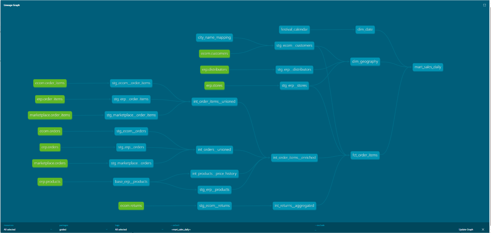
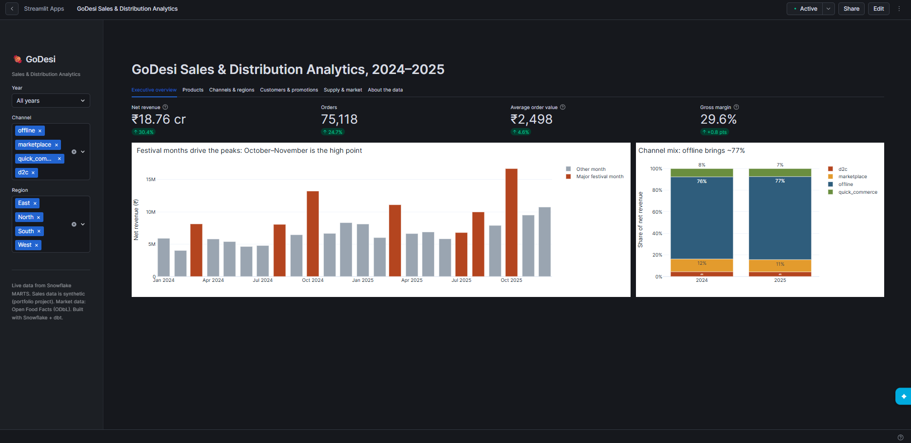
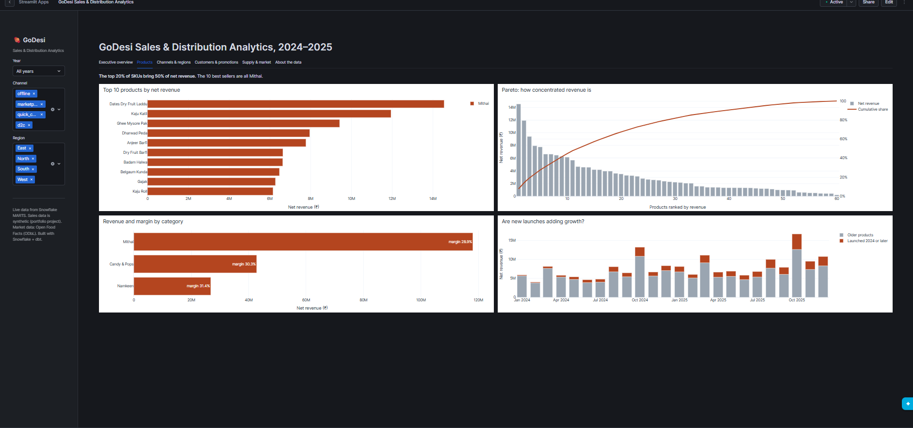
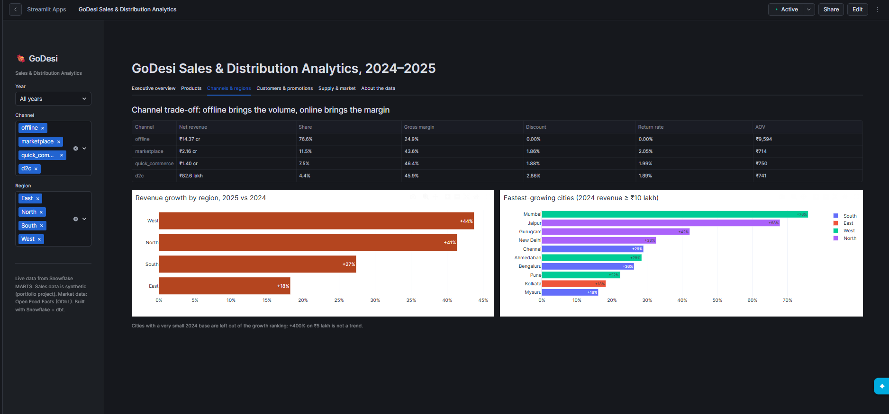
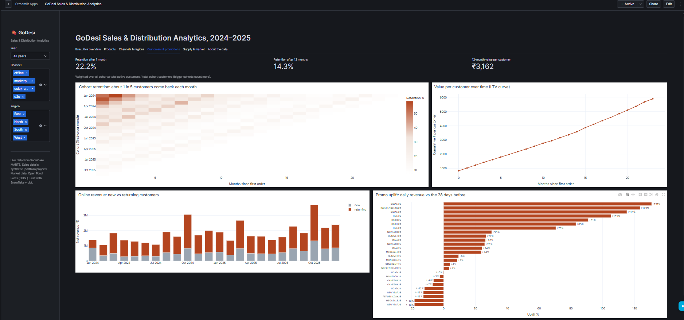
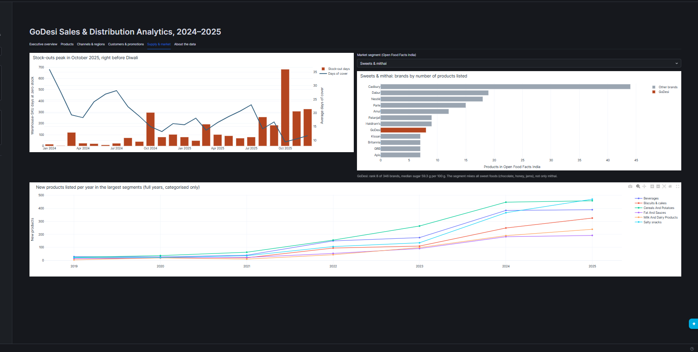

# GoDesi Sales & Distribution Analytics

An independent analytics project for **GoDesi**, a Bengaluru-based snack and mithai brand.
It combines real product data from Open Food Facts with synthetic sales data, and models it
with **dbt on Snowflake** into a tested star schema that answers real business questions
for dashboards.

> **Status:** Phases 0-6 complete (setup, data loading, dbt modeling, testing, documentation, analysis and dashboard).
> Next: Phase 7 (CI and scheduling).
>
> 📊 **Live dashboard: https://godesi-analytics.streamlit.app/** · 📝 **[Insights report for the founder](docs/insights.md)**

---

## Business questions this project answers

| # | Question | Mart |
|---|---|---|
| Q1 | How are revenue, orders and average order value trending by day, channel and state? | `mart_sales_daily` |
| Q2 | How does the channel mix (marketplaces, quick commerce, D2C, offline) compare on revenue and margin? | `mart_channel_performance` |
| Q3 | Which products, categories and new launches drive growth? | `mart_product_performance` |
| Q4 | Which regions and cities grow fastest? | `mart_sales_daily` + `dim_geography` |
| Q5 | Do customers come back? Retention and lifetime value by cohort | `mart_customer_cohorts` |
| Q6 | Where are stock-outs and overstock? | `fct_inventory_daily` |
| Q7 | Do festival promos (Diwali, Raksha Bandhan, Holi) lift revenue? | `mart_promo_impact` |
| Q8-Q9 | How does GoDesi's range compare with competitors on nutrition and category? | `mart_market_landscape`, `mart_category_growth` |

## Key findings

- Net revenue grew **+30.4%** from 2024 to 2025 (INR 18.76 crore over two years, cancelled orders excluded).
- **Offline** (kirana and modern trade) brings about **77%** of revenue at a 24.9% gross margin; online channels earn about 45%.
- **29 of 60 SKUs make 80%** of revenue; the top 10 are all mithai.
- **West** is the fastest-growing region (+44%) and has the best margin, because 41% of its revenue is online.
- **22.2%** of customers order again in month 1 and **14.3%** in month 12 (12-month revenue per customer INR 3,162), but newer cohorts repeat much less: month-1 retention fell from **34%** (2024 cohorts) to **12.5%** (2025 cohorts).
- **Diwali 2025** promo days averaged **+131%** daily revenue versus the 28 days before; 9 of 26 promos had negative uplift.
- **All 60 SKUs stocked out somewhere in October 2025** (681 warehouse-SKU-days, 9.4 days of cover), just before the festive peak.
- In the real Open Food Facts market data, GoDesi ranks joint **11th of 317 brands** in Sweets & mithai,
  with a median sugar content of 59.3 g per 100 g.

Each finding has its number, chart and recommendation in **[docs/insights.md](docs/insights.md)**.

*All sales figures come from synthetic data; the market comparison uses real Open Food Facts data.*

## Stack

| Layer | Tool |
|---|---|
| Warehouse | Snowflake |
| Transformation | dbt Core 1.12 + dbt_utils |
| Data generation | Python (pandas, numpy, faker) |
| Dashboard | Streamlit (in Snowflake + Community Cloud), Plotly; Power BI Desktop (Import) |
| Version control | Git and GitHub (feature branches and pull requests) |

## Architecture

```
GODESI_RAW (bronze)            GODESI_ANALYTICS
  ERP                            STAGING       (silver: cleaned, 1:1 with sources)       19 views
  ECOM                 dbt       INTERMEDIATE  (silver: unioned, SCD2 price join)         7 views
  MARKETPLACE        ------>     MARTS         (gold: star schema + business marts)      18 tables
  INVENTORY                      SNAPSHOTS     (product price history, SCD Type 2)
  OPEN_FOOD_FACTS                TEST_FAILURES (rows that failed stored tests)
```



**Star schema:** `fct_order_items` (one row per order line, incremental merge) and `fct_orders`, with
`dim_date` (festival windows), `dim_products`, `dim_customers`, `dim_channel`, `dim_geography` and `dim_stores`.

**Data problems handled in staging** (all on purpose in the raw data): city spellings
(Bangalore / BENGALURU / "Bengaluru "), duplicate marketplace orders, two timestamp formats,
prices as text ("Rs. 120.00"), late status updates, price changes over time, and impossible
nutrition values in Open Food Facts.

## Dashboard

**Live: https://godesi-analytics.streamlit.app/**. Six tabs, filtered by year, channel and region:

| Tab | Questions | What it shows |
|---|---|---|
| Executive overview | Q1, Q2 | KPIs vs last year, monthly revenue with festival months, channel mix |
| Products | Q3 | Top 10 SKUs, Pareto curve, category margin, new launches |
| Channels & regions | Q2, Q4 | Channel table (margin, discount, returns), region growth, fastest cities |
| Customers & promotions | Q5, Q7 | Cohort retention heatmap, LTV curve, new vs returning, promo uplift |
| Supply & market | Q6, Q8, Q9 | Stock-out days and cover, brands in the segment, new products per year |
| About the data | | Sources, definitions, limitations |



<details>
<summary>More screenshots</summary>






</details>

**One app, two places to run it** (`dashboard/streamlit/`):
- **Inside Snowflake (Streamlit in Snowflake):** reads the marts **live** through the Snowpark session, owned by the
  read-only **REPORTER** role. Setup: `setup/05_streamlit_app.sql`.
- **Public (Streamlit Community Cloud):** the same `app.py` reads small CSV exports of the marts
  (`dashboard/streamlit/marts/`, under 1 MB, no customer personal data), so the link keeps working without Snowflake
  credentials or credits. Refresh them with `python scripts/export_marts.py`.
- All SQL lives in `queries.py`; the live and exported data were checked to be identical.

**Power BI version:** `dashboard/GoDesi_Sales_Analytics.pbix` (Import mode, REPORTER role): a star schema with
9 relationships and DAX measures (net revenue, margin %, AOV, YoY, retention) written as code in `dashboard/model/`.

**Analysis queries:** one SQL file per question in `godesi/analyses/` (`dbt compile -s "path:analyses"`).
They produce the numbers in the insights report, and the dashboard matches them (net revenue INR 18,76,44,075; 75,118 orders; AOV INR 2,498).

## Testing and data quality

Every `dbt build` runs **144 data tests and 1 unit test**:

| Type | What it checks | Examples |
|---|---|---|
| Primary keys | `unique` + `not_null` on every model | `order_item_id`, `sku_id`, `customer_id` |
| Grain | `dbt_utils.unique_combination_of_columns` | inventory: date + warehouse + SKU |
| Accepted values | allowed categories | channel, order status, Nutri-Score A-E, region |
| Relationships | every foreign key exists in its dimension | `fct_order_items.city` -> `dim_geography` |
| Business rules | `dbt_utils.expression_is_true` / `accepted_range` | discount <= gross revenue, price <= MRP, stock >= 0 |
| Singular tests (5) | rules across models | no order before signup, no sale before launch, revenue reconciles across facts and marts, SCD2 ranges without gaps or overlaps, refund <= amount paid |
| Unit test | logic on hand-made rows | SCD2 price picked at order time + revenue and margin formulas |
| Source freshness | raw data loaded recently | warn after 24 h, error after 72 h |

**What the tests found:** the business-rule tests caught real problems that were then fixed:
9 Open Food Facts products with impossible values (up to 2,000 g sugar per 100 g), and price
changes that took effect at midnight while the ERP recorded them at 09:00. Two SKUs with ERP
price changes dated before their launch remain as a **warning** (failing rows stored in a table
for the ERP owner), because the fix belongs in the source system, not in dbt.

## Documentation

- Every column of the 18 mart models is described; KPI definitions (net revenue, gross margin %,
  AOV, retention, days of cover, promo uplift) live once in `models/docs.md` and are reused everywhere.
- Descriptions are also written to Snowflake as table and column comments (`persist_docs`).
- The dashboard is registered as a dbt **exposure** (with its URL), so the lineage graph runs from raw sources to the dashboard.
- Browse it locally: `dbt docs generate` then `dbt docs serve`.

## How to run

```bash
cd godesi
dbt deps                     # install dbt_utils
dbt seed                     # mapping tables and festival calendar
dbt source freshness         # stop here if the raw data is stale
dbt build                    # models + snapshots + all tests, in dependency order
dbt build --target prod      # the production schemas
```
Connection details live in `~/.dbt/profiles.yml` (not in this repo); dbt connects as a service user with a key pair.

## Security and cost setup

- Three least-privilege roles:
  - **LOADER** writes raw data only.
  - **TRANSFORMER** reads raw data and builds the models; dbt uses this role.
  - **REPORTER** reads the marts only, for dashboards.
- dbt connects as a **service user** with key-pair authentication. No passwords or keys are stored in this repo.
- An X-Small warehouse with a 60-second auto-suspend, and a **resource monitor** that caps monthly credits.
- The setup is a rerunnable script: `setup/01_snowflake_setup.sql`. Role access tests are in `setup/02_role_tests.sql`.
- The dashboard only ever uses **REPORTER** (in Snowflake and in Power BI); customer names, emails and pincodes are never exported.

## Data sources

- **Open Food Facts** (https://world.openfoodfacts.org): real product data for India
  (26,293 products), used under the [Open Database License (ODbL)](https://opendatacommons.org/licenses/odbl/1-0/).
- **Sales, customers, stores, inventory**: synthetic, generated by `scripts/generate_data.py`
  with a fixed random seed, so results are reproducible.
  Only the 9 GoDesi products found in Open Food Facts are real; all sales figures are made up.

## Repository structure

```
setup/              Snowflake setup, role tests and raw-data load scripts (SQL)
scripts/            Python data generator and load-script builders
dashboard/          Streamlit app (app.py, queries.py, exported marts) and Power BI model files
godesi/             dbt project
  models/staging/       one folder per source system
  models/intermediate/  unions, SCD2 price history, enrichment
  models/marts/         core star schema, sales, marketing, supply_chain, market
  models/docs.md        project overview and KPI definitions
  seeds/                brand, channel and city mappings, festival calendar
  snapshots/            product price snapshot
  macros/               safe_divide, standardize_city, limit_in_dev, generate_schema_name
  tests/                singular tests
  analyses/             Q1-Q9 analysis queries
docs/               Insights report, diagrams and dashboard screenshots
data/               Local data files (ignored by git)
```

## Roadmap

- [x] Phase 0: environment, Git, Snowflake practice
- [x] Phase 1: Snowflake setup as code (warehouse, databases, roles, grants, service user, cost guard)
- [x] Phase 2: load real and synthetic raw data
- [x] Phase 3: dbt project setup
- [x] Phase 4: data modeling (staging, intermediate, star schema)
- [x] Phase 5: testing and documentation
- [x] Phase 6: analysis, dashboard (Streamlit + Power BI) and insights report
- [ ] Phase 7: CI, scheduling and cost review

## Author

Vivek Hegde
